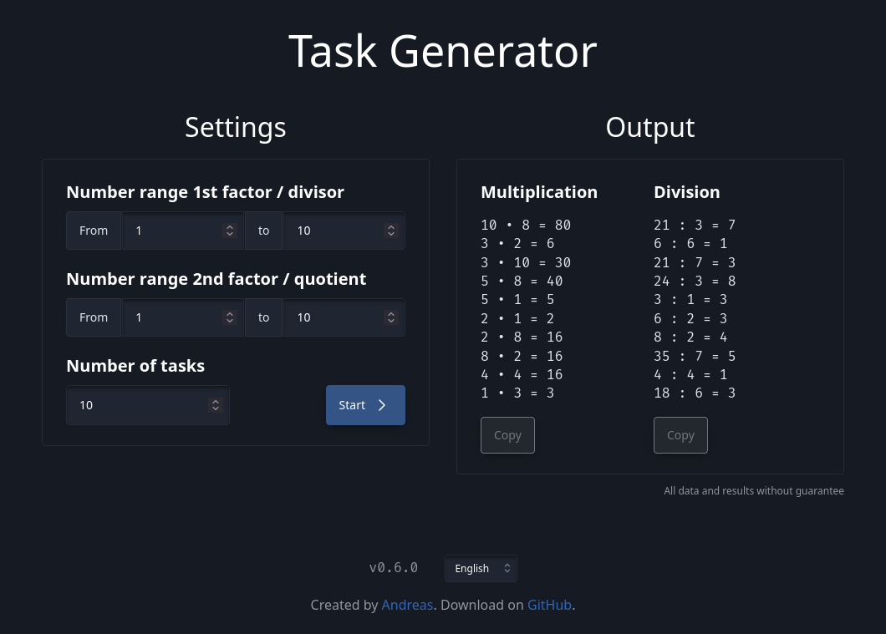

# Task Generator

A web app to generate simple multiplication and division tasks. Built on Vue.js and Sloth.css.

## Demo



<https://tasks.devmount.de>

## Features

- Ranges for input numbers can be configured
- The number of tasks can be configured
- Support for division by zero
- Directly copy results to clipboard

## Get started

1. Get all files

    ```bash
    git clone https://github.com/devmount/task-generator
    ```

2. Install dependencies

    ```bash
    cd task-generator
    pnpm install
    ```

3. Either start the development server with hot reload at localhost:8080 ...

    ```bash
    pnpm run dev
    ```

4. ... or create a production build with minification

    ```bash
    pnpm run build
    ```
